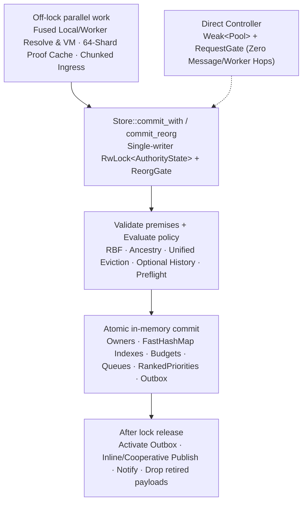
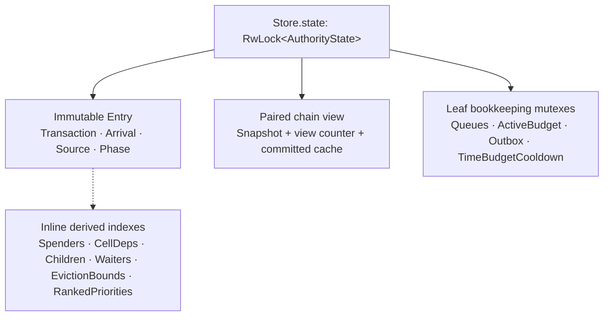

# Transaction-pool architecture

The pool is built around **off-lock parallel computation → single-writer atomic commit → ordered off-lock publication**.
Expensive resolution, canonical VM verification, payload compaction, template packing, JSON conversion, callbacks and payload drops run concurrently outside any pool write lock. All authoritative pool state lives in one short-hold `RwLock<AuthorityState>`, so admission, RBF replacement, capacity eviction and chain reconciliation read live facts directly, preflight every invariant and commit atomically without distributed-lock retries or multi-shard transaction machinery (completing in microseconds on warm single-entry paths, while batch evictions and fork reconciliations scale with the affected subgraph).

## The architectural core

| Concept | Responsibility |
|---|---|
| `Premises` | Retains the original off-lock observations (chain view, owner `Weak<Entry>` identities, input spenders) checked inside `commit_with` before mutating live state |
| `AuthorityState` | Single authoritative in-memory store holding owners, `FastHashMap` digest indexes, dependency/child/spender/waiter/peer/eviction indexes, inline account usage, `RankedPriorities` and the paired chain snapshot |
| `Store::commit_with` & `ReorgGate` | Enforces the single-writer boundary with priority preemption for reorgs: validates fault/premises, runs zero-alloc single-edit or chunked preflight + infallible index application, releases the write lock, then activates outbox batches, wakes waiters and drops displaced payloads |
| `Outbox` & `TxPoolPublisher` | Preserves ordered publication obligations (callbacks, relay, batched `RecentReject` RocksDB writes, peer bans, fee estimator) after commit on a dedicated `TxPoolPublisher` OS thread, with cooperative assist (`Pool::publish_assisted`) on blocking paths and flat-combining inline drain (`Batch::activate_nonblocking`) on callback-free local fast paths |
| Direct `TxPoolController` & `RequestGate` | Executes reads and mutations directly against `Weak<Pool>` under bounded ordinary, external-read and isolated callback-read semaphores plus a shutdown drain barrier—spawning admitted remote batches onto the service runtime and keeping one ordered `ChainControl` lane for chain/admin transitions |
| Sharded `TxVerificationCache` | Partitions verified `ScriptVerificationProof` entries into 64 hash shards so concurrent pool workers, template refreshes and parallel block verification never contend on a global cache write lock |

A transaction has one current immutable owner. Raw hash is its lookup key; the
`Arc<Entry>` instance distinguishes successive owners at that key. Witness hash
identifies VM payload. Expensive resolution, verification, template packing and
external calls stay outside `AuthorityState` locks.

A queued transaction crosses this boundary more than once: ingress installs its
first owner, resolution commits Verify or Waiting, and admission commits Accepted.
Queue selection and computation themselves do not change owner phase.

For replacement and capacity eviction, membership evaluates RBF, backing,
ancestry, late-producer edges and victim selection directly against live
`AuthorityState` inside the single-writer cut, after verifying that off-lock
`Premises` still match. If an observed spender, producer or chain view changed,
commit returns `Stale` without mutating state or reserving effects. Publication
is ordered, but never executes while `AuthorityState` is locked.

## Facts, owners and projections

The owner is the retained transaction fact; indexes locate and classify it.
Source records permissions/provenance, while phase records its current work or
accepted/recovery state. A phase change creates a new owner instance. The paired
view supplies chain context and invalidation. Public pending/gap/proposed position
is a projection against that view, distinct from the owner's admission phase.
Gap is the proposal-to-commit delay of the two-phase protocol. Missing dependencies
never assign Gap: Waiting owners count as orphans and have no accepted pool status.
[Entry and Source](../src/authority/model.rs) define these facts.

Policy modules (`ingress`, `membership`, `chain`, `waiting`) run their atomic
decisions through **`Store::commit_with`**; `AuthorityState::apply_edits` alone
mutates live owners and their derived projections. `Pool` owns jobs, computation
admission, scoped verification pauses and request coordination. Block verification
pauses background workers across a chain backlog and pauses local RPCs only when
a block contains uncached scripts needing parallel VM execution, while
reconciliation and publication remain live. The builder owns startup and task
joins. Jobs, suspended VM state, active reservations and publisher endpoints have
their own lifetimes, explained in [execution](architecture/EXECUTION.md).
Consensus and VM truth remain in the canonical verification crates.

## Responsibilities in code

| Change or review target | Entry point |
|---|---|
| Direct request controller, admission gate and chain-control boundary | [controller](../src/service/controller.rs), [gate](../src/service/gate.rs), [message](../src/service/message.rs) |
| Active jobs, dedicated compute pool, scoped pause control and direct requests | [Pool](../src/authority/service.rs), [compute](../src/authority/service/compute.rs), [execution](../src/authority/service/execution.rs), [submission](../src/authority/service/submission.rs) |
| Policy decisions | [ingress](../src/authority/ingress.rs), [membership](../src/authority/membership.rs), [eviction](../src/authority/eviction.rs), [chain](../src/authority/chain.rs) |
| Single-writer state, descendants, waiters, preflight, atomic apply and store boundary | [state](../src/authority/state.rs), [descendants](../src/authority/state/descendants.rs), [waiters](../src/authority/state/waiters.rs), [Store](../src/authority/store.rs), [ranks](../src/authority/ranks.rs), [budget](../src/authority/budget.rs) |
| Low-cardinality operational metrics | [metrics](../src/metrics.rs), [workspace metrics](../../util/metrics/src/lib.rs) |
| Retained representation and runnable work | [model](../src/authority/model.rs), [residency](../src/authority/residency.rs), [queues](../src/authority/queue.rs), [waiting](../src/authority/waiting.rs) |
| Resolution, canonical checks and sharded proof cache | [jobs](../src/authority/jobs.rs), [bounded resolution provider](../src/authority/jobs/resolution.rs), [verification](../src/verification.rs), [cache](../../verification/src/cache.rs) |
| Committed effects and relay reconstruction | [notice](../src/authority/notice.rs), [relay](../src/authority/relay.rs) |
| Queries and mining output | [query](../src/authority/query.rs), [template](../src/authority/template.rs), [packing](../src/authority/packing.rs), [compiled causal graph](../src/authority/packing/graph.rs), [packing run](../src/authority/packing/run.rs), [conditional ordering](../src/authority/packing/ordering.rs), [block assembler](../src/block_assembler/mod.rs) |
| Startup, shutdown and disk format | [builder](../src/service/builder.rs), [persistence](../src/persisted.rs) |

## Read the details

- [Commit and concurrency](architecture/COMMIT.md): premise validation, preflight,
  atomic single-writer mutation, strict two-level lock order, unified eviction
  and chunked pending ranks.
- [Execution and lifecycle](architecture/EXECUTION.md): owner phases, scheduling
  and scoped block priority, resource lifetimes, publication, reorg, templates
  and shutdown.
- [Maintenance](MAINTENANCE.md): configuration, caller migration and diagnosis.
