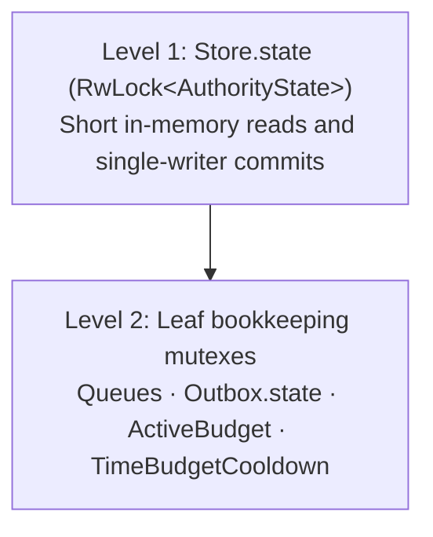
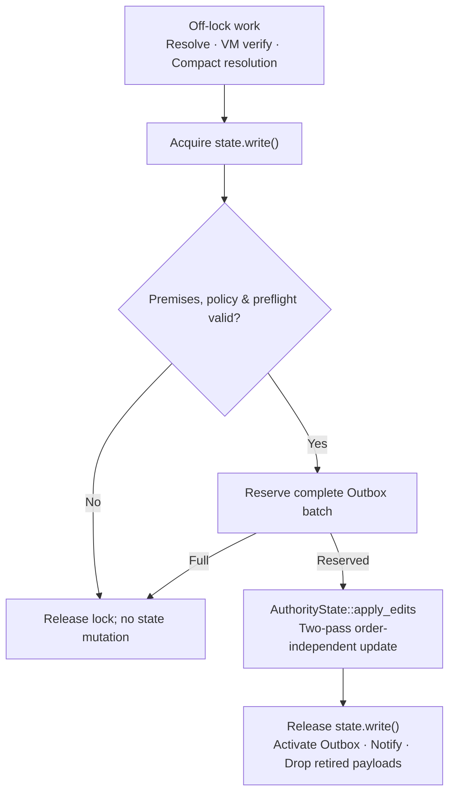

# Commit and concurrency

[Architecture overview](../ARCHITECTURE.md) introduces the core. This page explains
how [Store::commit_with](../../src/authority/store.rs) and
[AuthorityState](../../src/authority/state.rs) validate off-lock premises,
preflight invariants and commit coupled mutations atomically under a strict
two-level lock hierarchy. [Execution](EXECUTION.md) owns the surrounding job and
effect lifetimes.

## Off-lock premises and live-state decisions

Heavy work (dependency resolution, canonical VM verification, compact resolved
payload construction) runs concurrently off-lock, including transactions that
share read-only `cell_deps`. Read-only admission previews (`test_accept_tx`)
validate completely under `state.read()` without acquiring the writer lock.
Final in-memory state commits intentionally serialize under `Store`'s
single-writer `RwLock<AuthorityState>` without multi-shard locking or
optimistic cross-shard retry cascades. Under the write lock, cached
descendant-aggregate lookups (`AuthorityState::descendants`) are $O(1)$ per
root, while full-pool eviction still scans bounded candidate bounds, removes
victim closures, and reconciles late-producer relationships; ordinary leaf
admissions complete in microseconds on warm single-entry paths, whereas large
batch evictions or fork reconciliations scale with the affected subgraph.
During off-lock resolution,
[Premises](../../src/authority/model.rs) records the exact facts that authorized
that work:

| Observation | Why it is needed |
|---|---|
| Paired lifecycle view | Reorg or same-tip clear invalidates work even when a tip identifier alone looks unchanged |
| Positive owner identity (`Weak<Entry>`) | The same transaction hash can leave and reenter; an old worker must not act on its successor, and retained weak control blocks prevent pointer-reuse ABA without pinning retired payloads |
| Owner absence | A missing producer or predecessor can appear before commit |
| Observed input spender | RBF and backing validation must see whether an input's pool spender changed since resolution |

Inside `Store::commit_with`, `AuthorityState::validate_premises` checks those
off-lock observations first. Once they hold, policy decisions (`membership`,
`eviction`, `ingress`, `chain`, `waiting`) inspect the live, coherent
`AuthorityState` directly—there is no second multi-shard read-set cache or
optimistic conflict-retry loop for in-memory relations.

Blake2b-256 digest maps (`owners`, `proposals`, `children`, `preaccepted_owners`,
`ReaderSet::Many`, `Premises::owners`, `RankedPriorities::by_hash`) and compact
stack-owned `OutPointKey` (`[u8; 36]`, `Copy`) maps (`spenders`, `cell_deps`,
`Premises::spenders`, `ChainFacts::spent`) use the zero-dependency
`HashKeyBuildHasher` (mixing `OutPointKey` indices with bijective Fibonacci
hashing), eliminating both SipHash and `compact_packed` heap allocations on hot
indexes while preventing buffer retention by type. Resolution batches initial
inputs, cell deps and static `SYSTEM_CELL` members under a single
`Store::observe_resolution` read lock (skipping redundant RocksDB lookups on
cached system cells and copying all pool cell payloads off-lock), and admission
precomputes accepted base charges and compact relay hashes off-lock before
entering `Store::commit_with`. Single-owner commits pass through stack-allocated
`EditBatch::One` and zero-allocation `AccountUsage::check_single`, while P2P and
proposal batches commit fresh prefixes in chunks of up to 32 transactions
(`INGRESS_BATCH_CHUNK`) under a single write lock.

## Priority-preempting two-phase parallel reorg

`Store` pairs `RwLock<AuthorityState>` with a lock-free fast-path `ReorgGate`
(`pending: AtomicUsize` + `Mutex<()>` + `Condvar`). Normal writes
(`commit_with`), heavy full-pool captures (`capture`) and rank installs yield
before contending for `state` whenever `reorg.pending > 0`, while fast point
reads (`point`, `observe_resolution`, `read_template`, `capture_summary`,
`live_cell`, `compact_lookup`) never block on `ReorgGate`.

`chain::commit_reconcile` runs in three phases:

1. **Off-lock preparation**: extracts canonical `ChainFacts` and compacts
   detached block transactions in parallel across threads (`std::thread::scope`)
   for large forks.
2. **Read-phase parallel planning**: under a shared `state.read()` guard (so
   concurrent RPC reads continue uninterrupted), plans conflicts, detached-header
   or rule-change recovery scans (which may scan the live owner table across
   threads when detached blocks or script-rule changes occur), descendant
   closures, `edits`, `effects`, wake hints, and localized connected-component
   proposal callbacks (`collect_surviving_component`, reducing callback
   aggregation from $O(|\text{pool}|)$ to $O(|\text{component}|)$).
3. **Atomic write cutover**: acquires `state.write()` via
   `Store::commit_reorg`, confirms `state.view == base_view` and either an
   unchanged `mutation_epoch` or a bounded disjoint-leaf delta in
   `recent_leaf_inserts`, then applies the pre-built plan directly. Steady-state
   forward blocks without structural churn cut over in microseconds; if a
   concurrent structural commit raced during optimistic Phase 2, reconciliation
   immediately acquires `Store::enter_reorg_priority()` to pause ordinary
   writers and retries cleanly, guaranteeing reorgs never starve under heavy
   traffic.

### Example: replacing an input spender

Suppose candidate B spends the same input as accepted A, and C depends on A.
Off-lock resolution and VM verification produce `Verified` plus its `Premises`,
and compact `accepted_resolution` off-lock. Inside `Store::commit_with`:

1. `state.validate_premises` confirms the chain view, observed owners and spenders still match.
2. `evaluate_admission` inspects live `state.spenders`, `state.children` and `state.cell_deps` to compute the complete RBF victim closure `{A, C}`, validate backing, check producer ancestry and late-producer readers, and run unified capacity eviction if needed.
3. Optional replacement history is decided in **one single pass** against live `state.usage.history` and `limits.history` (no second lock retry).
4. `state.preflight_edits` checks revision arithmetic, proposal short-ID uniqueness, peer bans, accepted-spender uniqueness, exact inline `AccountUsage` quotas and wake-pass bounds.
5. `outbox.commit` reserves the complete ordered notice batch.
6. `state.apply_edits` mutates all owners, indexes, queues, `eviction_bounds` and `pending_ranks` infallibly.
7. The write guard drops; `Store::publish_commit` activates the outbox batch (or flat-combines callback-free in-memory local fast-path batches inline via `Batch::activate_nonblocking`), notifies waiters/template driver and drops displaced `Arc<Entry>` payloads outside the lock.

If any step in 1–5 returns `Stale`, `Rejected` or `Full`, nothing is mutated
and no partial victim removal becomes visible.

## Preflight, atomic mutation and lock hierarchy

Lock ordering has **strictly two levels**:
1. `Store.state: RwLock<AuthorityState>`
2. Leaf bookkeeping mutexes (`queues`, `outbox.state`, `budget.active`, `budget_cooldown`)

Leaf mutexes never acquire `Store.state`. Queue selection releases its lane
before owner lookup; maintenance releases its wake snapshot before off-lock DB
reads; displaced payloads and replaced collections are returned inside
`CommitOutcome::retired` and dropped strictly after the write guard closes. No
lock ever spans `.await`, RocksDB I/O, VM execution, callbacks or payload
destruction.

Inside `AuthorityState::apply_edits`, mutations execute in an order-independent
two-pass sequence:
1. **Pass 1**: Skip no-op `Arc::ptr_eq` edits; detach all `before` entries from
   owners, spenders, `cell_deps`, `children`, waiters, peers, deadlines, queues,
   `eviction_bounds` and `pending_ranks`; attach all `after` owners and accepted
   graph edges; bump `accepted_revision` and `accepted_removal_revision`; bump
   `rank_generation` only when an accepted rewrite or a removal with surviving
   accepted children can reprice descendants.
2. **Pass 2**: Register new `Waiting` and `Replaced` rows against the final
   `spenders` table so `RecoveryTriggers::defer_creation_event(spent)` is
   independent of edit hash order, initializing newly created wait rows from
   the monotonic `wake_epoch` high-water mark so retired/recreated rows cannot
   alias stale wake passes.
3. **Pass 3**: Advance dirty wake rows (skipped in O(1) when `waiters` is empty).

`preflight_edits` checks every fallible condition before `outbox.commit` and
`apply_edits` run, with a zero-allocation fast path for single-edit commits.
Allocation follows Rust's abort-on-OOM contract; any structural integrity fault
sets the shared `faulted` flag, wakes all waiters and prevents persistence.

For lifecycle transitions (`apply_lifecycle`), owner edits install against the
old view first, then `gap_count` and `proposed_count` advance against the new
snapshot using the final owner table (bounded by `ProposalView` deltas when the
window is small, or full scan when large), and committed transaction hashes
record into the bounded LRU cache keyed by proposal short ID.

## Dependency, replacement and eviction decisions

[Jobs](../../src/authority/jobs.rs) resolve against the chain snapshot and accepted
overlay while recording producer/spender premises. A pool spend does not make
chain backing dead; [membership](../../src/authority/membership.rs) decides RBF.
Admission requires every resolved cell that was observed spent during resolution
to have its spender retired by this replacement, and every pool-backed cell to
retain a live producer after replacement. Earlier `cell_dep` readers may coexist
with a later spender in the accepted pool; [packing](../../src/authority/packing.rs)
orders retained earlier readers before the spender across blocks without adding
them to the causal ancestor budget.

RBF counts shared descendants once, validates complete backing, and commits
candidate plus victims atomically. Replacement victims, late-producer
descendants and capacity victims share one 100-entry admission limit
(`MAX_POOL_MUTATION_CANDIDATES`), counting their union and excluding the new
candidate. Self-eviction rejects the candidate with `Reject::Full` without
evicting incumbents.

### Unified capacity eviction

[Eviction](../../src/authority/eviction.rs) maintains one global ascending
`BTreeSet<EvictionRank>` lower-bound index (`AuthorityState::eviction_bounds`).
An entry's `EvictionRank::lower_bound` uses `Status::Pending`, its own fee rate
and `descendants = 1`; proposal advancement and descendant growth can only raise
its true rank. When capacity pressure occurs:

- `select_victims` scans `eviction_bounds` in ascending order and stops as soon
  as `bound >= winner`.
- Leaf candidates (`!state.children.contains_key(&hash)`) score in O(1) with
  zero heap allocation.
- Non-leaf candidates walk their bounded descendant closure; protected proper
  ancestors of the candidate score their virtual descendant closure including
  the candidate and surviving late descendants.
- Both leaf admissions and late-parent admissions use this single unified path,
  avoiding any full-pool virtual graph clone.

### Chunked pending priority ranks

[RankedPriorities](../../src/authority/ranks.rs) lazily maintains pending and gap
transaction priorities in fixed-size sorted chunks (`CHUNK_TARGET = 128`) keyed
by `(AncestorsScoreSortKey, [u8; 32])`, paired with `rank_generation` and
`max_ancestors_bound`:

- A fresh or reset generation starts with `pending_ranks` unbuilt
  (`RankedPriorities::invalid()`), so admission and block-reorg writes incur
  zero rank-index CPU or memory overhead unless `get_tx_detail` is queried.
- Once a `get_tx_detail` query rebuilds and installs the index off-lock,
  independent admissions and removals maintain it incrementally in
  `O(log N + chunk)` inside `apply_edits` using the admission's already-validated
  ancestor aggregate, and subsequent detail queries count higher-priority entries
  in O(chunks) while walking live children directly.
