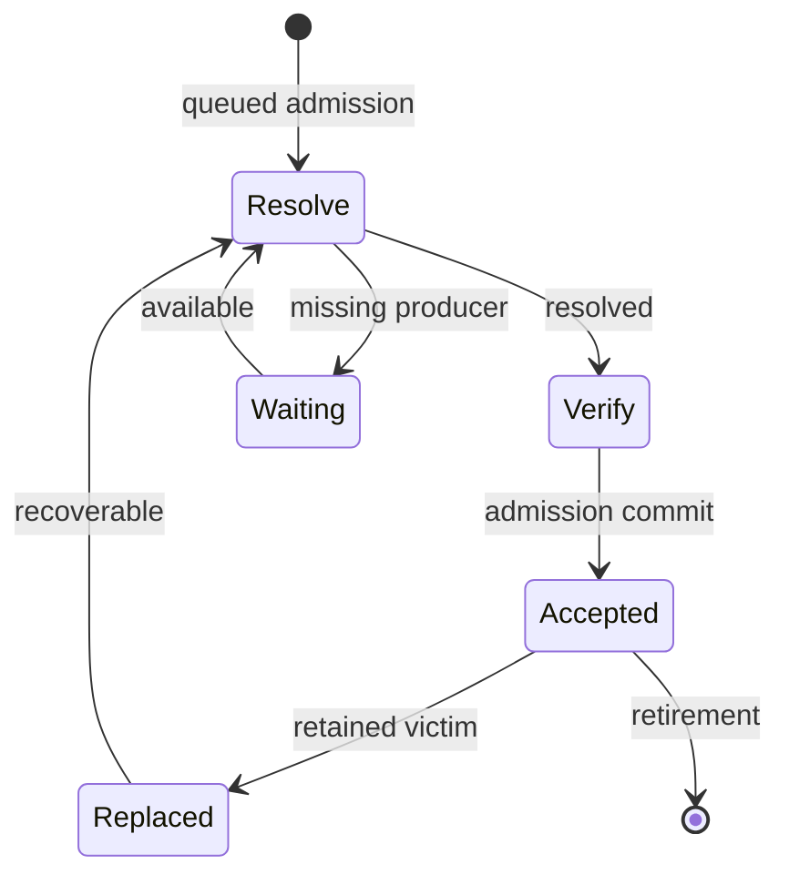
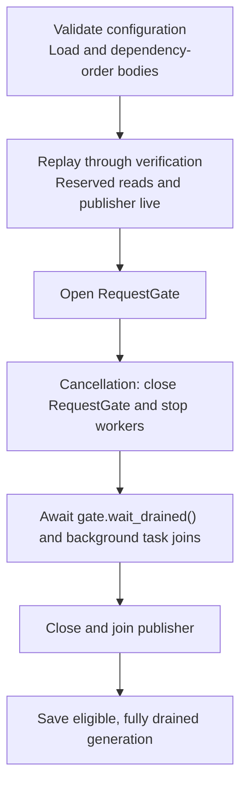

# Execution and lifecycle

[Architecture overview](../ARCHITECTURE.md) describes the core;
[commit and concurrency](COMMIT.md) explains its atomic boundary. This page follows
who owns work and resources before, during and after that boundary.

## Owner phases and jobs

The diagram shows queued progress; rejection, clear and chain changes can retire
owners across phases. Every owner-state arrow commits atomically through
`Store::commit_with` (or priority `Store::commit_reorg`); selecting a queue item
or running a Job adds no owner phase. When a `Verify` worker pops a `Resolve`
job while `queues.verify` is empty, `resolve_and_verify_fused` executes
`Resolve -> Verify -> Accept` directly without an intermediate `Phase::Verify`
write lock or queue round-trip (valid under both `fee_rate` and `arrival_time`
ordering). A Replaced owner is optional recovery history, not accepted
membership. Local submit/dry-run fuse resolution and synchronous VM/proof-cache
verification on a dedicated `ComputePool` worker (`TxPoolCpu-*`); only
successful local admission installs an Accepted owner, and dry-run installs
none. The integration-test submission RPC also resolves locally, but
acknowledges a Verify owner before background script verification. All RPC entry
points reject missing or spent dependencies instead of creating Waiting owners.

Ordinary local RPC submission acquires a bounded `RequestGate` ordinary permit
and hands admitted work off to `ComputePool` (or to the service runtime before
startup), while the RPC future only awaits the reply. The service owns an
admitted request through verification, admission and required publication even
if the RPC caller disconnects or hits an HTTP timeout. Its synchronous
controller adapter checks immediate refusals before entering the blocking wait;
neither API runs verification inline on the HTTP future or adds another
verification carrier.

Local preparation retains its initial own-hash identity directly and checks it
against successful resolution before verification. This check adds no premise to
the verification reads. Preparation rejections consume the resolution reads and
add that same initial owner; Waiting checks the owner before selecting its missing
cell rejection. Admission observes the initial owner inside `commit_admission`;
a verification rejection combines it with the resolved reads only when committing
the rejection. Queued local submission records the original absence when
installing Verify.

A competing membership decision can change eviction or replacement victims while
the verified transaction remains valid. Direct submissions and selected workers
re-evaluate admission inside `Store::commit_with` directly against live
`AuthorityState` after verifying the original lifecycle view, producer
identities, spenders and candidate predecessor still match. A changed premise
releases a direct attempt or requeues the still-current worker owner.
A suspended direct retry releases its active memory before waiting for CPU.

| Phase | Retained fact |
|---|---|
| Resolve | Raw payload awaiting or undergoing canonical resolution |
| Verify | Compact resolved cells, fee and original observations |
| Waiting | Current missing cell keys; no VM capability |
| Accepted | Sealed script proof and current fee, retained input cells, compact dependency identities and direct producer ancestry |
| Replaced | Optional transaction body with `BlockedDependencies` (all) or `RetryInputs` (any) |

[Queue](../../src/authority/queue.rs) selection transfers an immutable owner and
its non-Clone `ActivePermit` together to one non-Clone Job. It does not add a Working phase. A fixed
worker retains its completed result while awaiting settlement, so no Ready owner
or completed-result exchange is needed. A successor owner invalidates old jobs.
Unexpected drop of a current Job faults the generation; orderly cancellation
settles/requeues it or observes a successor.
`Store::is_current` is only an instantaneous owner-identity check. It creates no
observation and cannot substitute for a prepared decision's commit validation.

The resolution provider retains detached cells for one immutable chain snapshot.
Chain reads already own compact output and block-hash bytes; the provider copies
the caller's outpoint and shared-cache data at their retention boundaries.
A cell used first as an input and then as a dep-group reuses its cached metadata
when loading data. That upgrade still checks the original pool producer and
spender observations and charges the data before loading it.

## Scheduling and block priority

Resolve and Verify use separate queues because fee ordering requires resolved
fees. Both derive lanes from the same source/declared-cycle threshold and preserve
the configured selection order: `fee_rate` by default, or `arrival_time`. Completion can occur
in a different order. Block priority applies to every lane and to direct local
requests, independently of declared cycles.

An entry's `SizeClass` chooses its small/large bucket. A worker's `WorkSelection`
chooses small work only or both buckets in their normal order. With multiple
verification workers, the first is small-only, including its fallback to Resolve;
dedicated Resolve workers can select either size.

[Pool](../../src/authority/service.rs) admits resolution, direct input checks and
VM execution through shared compute permits and a bounded dedicated OS worker
pool ([`ComputePool`](../../src/authority/service/compute.rs), `TxPoolCpu-1..N`).
It checks the current pause after acquiring a permit, before selecting a queued
job or reserving active memory. A suspended waiter returns the permit and waits
for the control signal; dry-run declines without waiting. Memory budgets and
compute permits share one concurrency derivation
([`ConcurrencyPlan`](../../src/authority/budget.rs)): for `N` runtime workers
and `W` verification workers, shared/background work uses at most
`bg = max(1, min(W+1, N))` compute permits, while trusted local RPC may use
`local_headroom = if W == 0 { 0 } else { N.saturating_sub(bg + 3).min(2) }`
extra local compute permits (reserving at least 3 runtime cores for control/RPC
I/O, chain/template/publisher, and OS/network scheduling headroom so CPU-bound
VM threads do not preempt the HTTP reactor). `budget.limits.active_jobs` retains
the baseline `W + 2` slots when `W == 0` or `local_headroom < 2`, and reserves
the second extra active slot (`W + 3`) from pipeline capacity only when the
runtime actually grants `local_headroom == 2`. `ComputePermit` owns one slot; permitted
background work is drained strictly before unpermitted local fast-path work on
`ComputePool` so permitted callers never starve or deadlock and Tokio `GlobalRt`
avoids `block_in_place` thread churn. Local RPC futures always transfer admitted
work onto `ComputePool` (or the service runtime before startup) and only await
the reply, so an HTTP deadline returns independently while admitted work
finishes and releases its permit. When no other compute worker is busy (serial
local RPC traffic), at most one idle compute worker spins briefly (`100 µs`)
before kernel parking to keep serial handoff low-latency while automatically
disabling spinning under multi-worker concurrency or idle periods. Cold-start
creation of the first OS worker commits atomically with accepting its caller's
task, so a thread-creation failure only returns that caller's task and never
strands acknowledged work. CPU capacity is always released before settlement,
while the separate active-memory permit remains with its Job or direct request.
The sole effect publisher runs on a dedicated `TxPoolPublisher` OS thread
(isolating external callbacks, `RecentReject` RocksDB writes, peer bans and
block updates completely from `ComputePool` workers, falling back to an async
task only if thread spawn fails), batches multi-rejection writes into one
`RecentReject` RocksDB `WriteBatch`, and parks on a `Condvar` (`wake_lock` /
`wake_cond`) guarded by `wake_epoch` and `publisher_sleeping` (`Ordering::SeqCst`)
with zero periodic polling sleep. For local fast-path admissions whose leading
FIFO effects are purely non-blocking in-memory relay updates,
[`Batch::activate_nonblocking`](../../src/authority/notice.rs) flat-combines and
drains the ready non-blocking prefix inline (up to 32 batches per round, at most
2 rounds) under the same exclusive publisher lease using a `SeqCst` Dekker
`publisher_contended` handshake, waking `TxPoolPublisher` only when a blocking
head, shutdown close, or bounded-prefix spillover needs it.

An empty background queue does not contend for compute capacity. Its worker
still observes budget notifications, including accounting faults. Queued work
which cannot acquire peer or active memory retains the existing capacity wait.

The sole [block consumer](../../../chain/src/verify.rs) owns two scoped pauses:
`VerificationPause` suspends background pool queue workers across a queued chain
backlog (restoring on idle, shutdown or unwind), while keeping local RPC
submissions active during single-threaded DB writes and pool reconciliation;
`BlockScriptVerificationPause` additionally suspends local RPC VM execution
only when a block contains uncached scripts requiring parallel block script
verification, and skips the local pause entirely on warm blocks whose scripts
are already present in the sharded `TxVerificationCache`. Explicit external
`suspend_chunk_process` / `continue_chunk_process` pauses both lanes.

Reconciliation, IBD updates and generation clears share the ordered chain-control
driver. None consumes an ordinary transaction handler: those handlers may all be
waiting for the block consumer to resume verification. An IBD update completes
after earlier chain publication and before its caller releases the pause.

Pausing changes execution permission without retiring a transaction or its Job.
A running network VM cooperatively suspends with its scheduler state, consumed cycles,
compute permit and memory reservation retained; Resume continues that execution.
Already admitted synchronous work can finish, so a pause request does not establish
VM quiescence. Ingress can still queue bounded work. Reconciliation and publication
have their own progress requirements, described below, and remain outside this gate.

## Verification budgets and proof reuse

The transaction source selects a CPU-time budget only for network relay and
proposal verification. Local RPC submission, test submission, dry-run and recovery
have no time limit and use synchronous canonical verification. All sources
hand off their runtime worker during computation. This covers every poll of
canonical verification, including synchronous
verifier construction and scheduler preparation, as well as each VM child.
They pass the computation gate before starting and retain their work until
verification returns. Network verification uses the controlled VM child
with pause/stop/join. Proposal promotion preserves local and recovery sources.

Before accepting work, the pool calibrates the node's VM backend across two
fixed, reviewable synthetic kernels: an arithmetic/stack loop and a conditional
branch loop with 256 KiB page-strided memory traffic (64 × 4 KiB pages), each
running to five million cycles. Every `(kernel, ScriptVersion)` pair runs three
samples using the calling thread's CPU clock; the median suppresses isolated
measurement noise and the slowest per-cycle rate and slowest loading time set
the active timing. Loading uses fixed metadata, without ELF parsing or provider
I/O. The [budget adapter](../../src/verification/calibration.rs) keeps a
conservative 16× safety margin, adds per-script-group startup allowance
proportionally to distinct non-TypeID script groups, and floors small
declarations at one full loading/execution quantum. Neither rate nor startup is
a user setting or learned from peer transactions. To stay resilient across CPU
frequency shifts (such as cloud burst credits or heterogeneous P/E-core
migration) without risking peer calibration poisoning, trusted synthetic
recalibration refreshes lazily on `ComputePool` under a single-flight guard
every 10 minutes and on `ExcessiveVerifyTime` pressure with a 60-second
cooldown.

Declared network cycles select
`min(cap, max(minimum, per_group_load * script_groups + ceil(cycles / rate)))`,
capped at one minimum target block interval (`MIN_BLOCK_INTERVAL`, currently 8
seconds). Network work without a declaration and failed calibration both use
this internal cap. It is not a user setting. Native integration builds enable
the `test` Cargo feature to override `max_tx_verify_time_ms`; the field and its
parser do not exist in production builds.

Because `ExcessiveVerifyTime` never records a persistent rejection or bans a
peer, `Store` maintains a bounded (1,024-entry), non-persistent 30-second
in-memory cooldown keyed by `(tx_hash, witness_hash)` that applies solely to
replayed `Source::Remote` submissions and clears automatically on chain tip
advances and generation resets; local RPC submissions, recovery, proposals and
changed witnesses are never blocked. `Queues` additionally applies bounded,
work-conserving soft peer pacing when a remote peer exhausts a budget or burns
at least 1 second of VM CPU on a transaction: honest peers and trusted work run
ahead of the paced peer while contention exists, yet the paced peer is still
served immediately whenever no unpaced work is runnable.

Shared script proofs bind witness content, VM rules and resolved input/cell-dep
origins observable through header dependencies. Confirmation and reorg can change
the latter without changing the transaction hash. The canonical verifier derives
and checks this key as well as the pool/block cache callers.
Header/extension syscalls and cache identity share
[`header_visible_origin`](../../../script/src/syscalls/mod.rs). Changes to this
rule must preserve the independent syscall visibility and cache identity tests.
Expanded dep-group members have cell-dep indexes; group containers do not.

An Accepted owner retains its canonical script proof and derives cycles from that
proof. Shared-cache eviction therefore does not erase the result while the
transaction is waiting for proposal or block space. Internal fixtures carry only
synthetic cycles and cannot publish a canonical proof. Recovery verifies again;
neither persistence nor a declared cycle count can reconstruct this authority.

The [pool executor](../../src/verification/execution.rs) shares one remaining
CPU budget across ordinary VM groups and resumptions, dispatching production VM
slices onto `ComputePool` (`TxPoolCpu-*`) under `permitted` priority to avoid
`tokio::spawn` / `block_in_place` thread churn. Each slice returns its scheduler
ownership with its result and a CPU receipt taken on the execution thread.
Joining the slice acknowledges suspension and debits its CPU use before any
resume; there is no separate pause acknowledgment protocol. Determined consensus
failures (nonzero exit codes or non-`Pause` VM errors such as `CyclesExceeded`)
always take precedence over simultaneous budget exhaustion so invalid
transactions cannot hide behind `ExcessiveVerifyTime` to evade rejection or
peer banning; budget exhaustion still prevents over-budget successful slices
from entering the pool or relaying.

The private [CPU clock](../../src/verification/cpu_clock.rs) separates two roles.
The synchronous execution owns a precise timestamp that cannot move to another
thread. A transferable monitor observes the target thread's CPU progress and
requests a cooperative interrupt when it observes exhaustion. Remote reads
can lag, fail after thread exit, or include later work after the slice returns.
They never debit the budget or override the final receipt. Monitor failure joins
the child before deciding the outcome and rechecks completion before stopping
work; a stale observation cannot poison a completed slice's resume. The monitor
and interrupt belong to that slice and cannot affect its successor. Dropping the
caller interrupts and cancels its owned slice.

Checks sleep for the observed remaining CPU allowance, with a 1 ms floor matching
Tokio's timer granularity. Commands do not reset that wait. Suspend and Stop
interrupt immediately, without waiting for the next CPU check. OS scheduling,
remote counter lag and cooperative interruption still affect when execution stops;
this is not a hard wall-clock deadline. The precise receipt decides exhaustion,
including when normal completion races the monitor.

Queueing, suspension, parent polling delay, OS preemption and off-CPU provider
waiting spend no CPU budget. Root and dynamic program loading and provider CPU
work remain inside the charged scheduler slice. Calibration uses the same precise
thread CPU metric. If a receipt cannot be measured, the runner cannot accept or
resume work; a determined VM error or nonzero script exit still reaches canonical
error attribution. Other measurement failures are retryable local interruptions,
never malformed transactions. Type ID, cycle accounting and script error
attribution remain in the canonical verifier; the pool supplies its execution
policy.

## Settlement and failure

The [worker](../../src/authority/service/execution.rs) owns its Job through
settlement. Acceptance, rejection and requeue borrow the Job without acknowledging
it; only the worker calls `Job::mark_handled()` after successful settlement, including
its orderly-stop path. The active reservation is released only when the Job drops,
after its computation results. Owner residency and effect-batch capacity
have separate lifetimes and are not released by that marker.

[Ingress](../../src/authority/ingress.rs) commits the exhaustive resolution
result atomically: Ready validates its original premises and installs Verify;
Waiting installs its keys and derives any remote parent request from that same
owner; Rejected validates its premises and commits the rejection. Fresh P2P and
proposal batches also use `commit_ingress_chunk` to commit conflict-free,
within-budget prefixes of up to 32 transactions under a single write lock while
preserving proportional Tokio cooperative yields and exact single-transaction
fallback for duplicates, promotions, bans or quota refusals.

| Outcome | Who continues and what is retained |
|---|---|
| Stale verification premises | Worker requeues Resolve, or observes that a successor already owns progress |
| Outbox/chain pressure | Pool waits on state/capacity notifications and retries; owned work stays charged |
| Ordinary resource or verification rejection | Worker commits a rejection; stale rejection premises also require requeue |
| Structural fault | Generation stops normal use and becomes ineligible for persistence |
| Orderly cancellation | Worker settles/requeues work or observes its successor before leaving |

Capacity waits follow the refused gate. A full outbox waits for `outbox.room` or
`store.changed` notifications. Both subscriptions precede the attempt, so an
enabling change before the first wait poll is retained.

`Pool::commit_attempt` returns the successful attempt's result. Local admission
pairs its rejection outcome with the committed batch; reconciliation pairs the
batch with whether bounded recovery was used. Failed retries leave no separate
completion result for the caller to reconcile with the returned batch.

Fault detection belongs to its boundary. Outbox accounting or publisher failure
sets the shared fault flag and wakes outbox waiters; the service supervisor
observes publisher termination and calls `Pool::fault()` to stop and wake the
whole generation. Publisher failures have their own metric. `TypedFault` counts
the first transition made by `Store::fault()`, not every cause of a closed pool.

## Resource and lifetime bounds

[ResidencyLimits](../../src/constants.rs) derives byte ceilings from serialized
capacity, shared by admission, reorg payload and persistence-read bounds.
[Limits](../../src/authority/budget.rs) divides those ceilings into envelopes once;
[residency](../../src/authority/residency.rs) defines retained charges.
[Maintenance](../MAINTENANCE.md#configuration-and-capacity) owns defaults and tuning.

| Population | Ownership and bound |
|---|---|
| Accepted | Separate serialized bytes, conservative retained bytes and item count |
| Pipeline | Raw, resolved, waiting and recovery owners; charged bytes, items and edges |
| Active jobs | Derived with compute permits via [`ConcurrencyPlan`](../../src/authority/budget.rs) for `W = max_tx_verify_workers` (including zero) and `N` runtime workers: `W+2` baseline global slots, expanding to `W+3` only when `W > 0` and `N` grants the second trusted local compute permit (`local_headroom == 2`, keeping at least `3` runtime cores reserved for control/RPC I/O, chain/template/publisher and OS/network headroom); `W+1` remote, `ceil((W+1)/4)` per peer; envelopes reserved from pipeline capacity without shrinking per-job caps |
| Remote/per-peer retention | Subquotas preserve trusted room under remote pressure |
| Replacement history | Charged to pipeline and smaller optional-history quotas |
| Effects | Complete batches reserved before commit, with remote limits and trusted/critical headroom |
| Scratch/concurrency | Bounded captures and graphs, fixed workers, bounded channels/read handlers and paged maintenance/relay work |
| Packing graph cache | At most one graph in the template loop, with numeric edges/aggregates and weak owner identities; invalidation releases it before replacement construction |

Each active permit reserves the same immutable per-job byte/edge envelope, so
active capacity is represented by total, remote and per-peer job counts. Those
counts have a separate mutex from owner charges. Selection obtains its permit
before removing queue work; refusal changes neither counters nor selection.
The permit retains its original peer until drop, even if a later owner promotion
changes the transaction's source.

Full owner captures (`capture_all` / `capture_accepted`) acquire one
`AuthorityState` read lock (`Store::state_read()`), clone the paired chain
`Snapshot`, lifecycle view/revision counters, the requested owner `Arc<Entry>`
handles, and the O(1) `independent_leaves` topology flag, then release the read
lock before returning. Capacity admission and replacement planning run directly
against live `state.usage` and `state.owners` under the single `AuthorityState`
write lock inside `Store::commit_with` (or read-only under `Store::preview_with`),
re-validating earlier off-lock owner and spender premises before applying edits.

Active waiters observe `Budget::active_changed`: permit release or a quota fault
wakes them. Returning retained owner quota wakes maintenance through
`Store.changed`; it does not make another active job admissible.
Dependency availability notifies maintenance only when it schedules an eligible
waiter pass. A creation event deferred for every waiter still advances its pass.
Lifecycle changes and the end of a chain pause also wake maintenance.
A maintenance page refused by notice capacity also waits for outbox room;
chain-blocked pages ignore refunds that cannot release their gate.

Direct local requests retain their verified data and active envelope while waiting
for their committed publication response. Background jobs can return their worker
and active permit after commit because the outbox owns the remaining obligations.
A blocked callback can therefore leave committed local work occupying active
slots until those callers settle; the ordinary handler count also bounds requests
arriving through the controller. Reconciliation and publication do not acquire
these compute slots.

Accepted owners retain input cells and an inline script proof, but reduce cell-dep
and dep-group cells to identity/provenance fields. Retained-byte charges include the
proof representation. A selected Verify job keeps its full resolved owner
charge until replacement. Detached cell backing must remain shared through the
resolver; a final owner check cannot bound an earlier duplicate allocation.
Bounds include source/destination overlap, container capacity and concurrent producers.

Full graph/query/template scratch, database caches, allocator overhead and VM
internals remain separate costs. Pool budgets are not a process-RSS cap. The local
VM CPU-time budget does not establish consensus invalidity or justify peer banning;
an exhausted attempt may be retried.

Controller ingress is a separate bounded population: [`RequestGate`](../../src/service/gate.rs)
enforces 512 ordinary permits (plus 16 external-read and 16 isolated
callback-read permits), and each remote transaction batch carries at most 1 MiB
of serialized payload. Admitted batch payloads alone can therefore occupy up to
512 MiB before container overhead. The network relay additionally limits its
outstanding batch submissions to 128. Accepted and pipeline byte charges start
inside the authority; they do not include these controller envelopes.

## Waiting, chain and recovery

Waiting records current missing cell keys. Invalid headers are rejected by canonical
resolution, not registered as waiters. Network sources may wait for an unknown
producer, including proposal work and remote work without declared cycles. Local
recovery requires a known preaccepted producer that can supply the exact output.
Maintenance rotates pages of at most 32 waiters and gives due
expiration opportunities. This bounds a step, not elapsed time under arbitrary
arrivals, repeated conflicts or stalled providers.

Reorg uses a reliable bounded `ChainControl` lane. The block consumer waits for
reconciliation and its required publication, so that lane, the publisher and
reserved reads must remain live while pool computation is paused.
`chain::commit_reconcile` runs in three phases: off-lock `ChainFacts` extraction
and parallel detached-transaction compaction; optimistic read-phase planning
under `state.read()` (parallelized across threads for detached-header/rule scans
when the pool is large) so concurrent RPC reads never stall; and a short atomic
cutover through `Store::commit_reorg` (microseconds on steady-state forward
blocks without structural churn). If a concurrent transaction commit
races with optimistic read-phase planning (`state.mutation_epoch` changed),
reconciliation immediately acquires `Store::enter_reorg_priority()` (`ReorgGate`)
to pause ordinary writers and heavy full-pool scans (while keeping fast point
reads unblocked) and retries cleanly, guaranteeing chain progress never starves.
Paired snapshots supply proposal facts; `ProposalView` and
`TwoPhaseCommitVerifier` remain the canonical reference. Detailed capacity
refusal selects bounded parent-first recovery. Success logs the refusal and does
not imply every candidate was retained. An oversized command replaces the
generation against the exact successor snapshot.

During read-phase planning, reconciliation inspects live `AuthorityState`
directly without copying unrelated owners. Detached transactions supply recovery
witnesses at the same raw hash. Preaccepted owners check their full declared
dependencies, including inputs absent from Waiting's triggers. Conflict reports
follow input order before expanded cell dependencies. Conflict removal takes
precedence when its descendant closure intersects recovery, and neither closure
crosses a newly committed producer.

Accepted owner removal derives its input and output wake keys inside
`AuthorityState::apply_edits`, so reconciliation adds explicit block hints only
where that removal does not already supply them (and skips hint collection
entirely when `state.waiters` is empty). Preaccepted, canonical-only and
detached bodies still contribute their block points when waiters exist.

Graph totals are built only for callbacks. Rejections compute `removal_totals`
for the removed set. Proposal callbacks project surviving owners through the
planned edits, computing aggregates only over the localized surviving connected
components (`collect_surviving_component`) of transitioning connected owners
while independent singletons compute totals in O(1), so committing a parent
updates its child's callback totals without scanning unrelated pool owners.
Pending and Gap share the public pending callback, so moving between them emits
no second notification or fee-estimator sample. Entering or leaving Proposed
still publishes its corresponding callback. Ordinary attachment skips
detached-backing checks, while VM activation is compared once between the
previous and next snapshots regardless of proposal phase.

When each canonical proposal view contains at most twice the observed accepted
population, reconciliation computes the bounded proposal-phase delta once and
reuses it for callbacks and `AuthorityState::apply_lifecycle`; larger windows
use per-owner lookup. Both proposal paths preserve deterministic owner-hash
callback order and the same phase rule. `commit_reorg` validates `base_view` and
`base_epoch`, installs owner edits against the old view first, then advances Gap
and Proposed counts using short-ID lookup in the final owner table before
installing the new view. This also covers a retiring owner handing its proposal
short id to a successor in the same commit.

Reorg invalidates cell backing by the producer hashes in detached blocks,
excluding transactions reattached on the new chain. A cell first resolved from
the pool has no block-location metadata even after its producer commits. Its
outpoint still identifies that producer, so its readers and their descendants
leave accepted membership in the reorg commit, before recovery workers run.

[Canonical time verification](../../../verification/src/transaction_verifier.rs)
owns which resolved cells and inputs require maturity or `since` checks. Its
`transaction_depends_on_time` query and the checks use the same candidate selection.
Admission retains the query result with the accepted resolution; a detachment
moves those owners and their descendants to recovery. The pool does not maintain
another list of time-rule applicability conditions. In particular, expanded
dep-group members participate in maturity checks, while group containers do not.

Optional replacement history may be omitted under pressure and can occupy quota
until relevant availability or clear. It has no ordinary remote TTL or accepted
timestamp. `RecoveryTriggers` owns the all/any readiness and creation-event
deferral rules. Trusted Waiting owners still scan later unavailable keys for a
lost producer even after finding a key that can wait. Recovery returns its body to verification; replay restores neither
accepted proof nor old blocker predicates. GenerationReset clears sync's known
and pending relay state; RelayDrain reconstructs current waiting-parent notices
in bounded pages after the mailbox drains, not all accepted transaction results.
The [relay module](../../src/authority/relay.rs) owns both the mailbox and this
reconstruction cursor. It holds Store weakly; the public receiver cannot prolong
the service generation. Batched drains reserve a bounded prefix before removal
and preserve reset order and ownership on allocation refusal.

## Ordered publication and projections

[Effect constructors](../../src/authority/notice.rs) select the required endpoints
and bound diagnostics before commit. Inside `Store::commit_with`,
`Commit::commit_edits` validates `preflight_edits` first, reserves the complete
`Outbox` batch second, and mutates live state third. A refused commit keeps no
speculative obligations.

[Outbox](../../src/authority/notice.rs) appends that batch with its owner commit and
activates it after guards open. A later ready batch cannot overtake an earlier
unready one. Each batch settles, returns capacity and releases publisher/FIFO
references before the next. Callback-owned clones have their own lifetimes.
The dedicated `TxPoolPublisher` OS thread owns the endpoints for the generation
(falling back to an async task only if thread creation fails) and parks on
`wake_lock`/`wake_cond` (`Condvar`) via `wake_epoch` + `publisher_sleeping`
(`Ordering::SeqCst`) whenever drained or idle—there is no timed polling sleep.
For callback-free in-memory local fast-path batches,
[`Batch::activate_nonblocking`](../../src/authority/notice.rs) flat-combines and
drains up to 32 ready non-blocking batches per round (at most 2 rounds) inline
under the same exclusive publisher lease without waking `TxPoolPublisher`.
For blocking batches, local submissions (when direct slots are not saturated via
`Pool::settle_publish`), local removals, chain reconciliations and clears
cooperatively borrow the same exclusive publisher via `Pool::publish_assisted`
(`outbox.try_publish()`) while awaiting batch settlement, completing at most one
ready prefix of 32 batches per poll. Neither path waits for that lease: a busy
publisher continues in its current owner, and `publisher_contended` ensures a
deferred wakeup reaches `TxPoolPublisher` when the lease drops. This removes an
extra scheduling round trip whenever the committing caller can publish
immediately, while preserving FIFO order and endpoint failure state. Replay and
direct-submission futures keep the independent publication wait so their caller
can supervise other work within the same poll. Cancelling the background owner
waits for a borrowed callback to return before retiring its endpoints or
reporting task completion.

`NoticeBudget::charged_by` owns cumulative quota membership: remote charges
remote, ordinary and total; trusted charges ordinary and total; critical charges
total. Per-batch limits are separate from these shared outstanding budgets.

One bounded rejection record supplies metrics, optional recent status and
diagnostics. Transient resource/time refusals keep their cause through publication
without entering the recent-reject index or database. Refused candidates attach
a bounded source/phase/peer context; Full additionally observes the five relevant
budget accounts. This snapshot is taken during rejection preparation after the
refusing operation returns, so concurrent usage may have changed. It does not
claim the exact reservation-time state.

The publisher emits these records at Debug under `ckb_tx_pool::rejection`, after
commit and guard release. An abandoned, stale or unactivated outcome emits none.
Expected RBF victim removal callbacks are excluded from candidate diagnostics;
their metrics, recent status, callback and relay obligations remain intact.
Context storage and bounded dynamic reasons are included in outbox byte charges.
The logger is a synchronous endpoint and must return for publication to progress.

Callback panic disables all callback kinds for that publisher; other endpoints
can continue. Relay disconnection disables relay publication. Recent-reject write
failure suppresses new writes for one second before another effect retries;
omitted records are not retained for replay. Publisher cancellation faults the
generation and preserves owned obligations. Synchronous endpoints must return for
publication and shutdown to progress; async abort cannot stop them.

Reserved bounded reads let callbacks query directly while their invoking admission
waits for publication. Direct callback mutation is rejected. A callback must not
join a helper thread that reenters the controller: its thread-local marker does
not follow that helper. In particular, preview and template requests from a helper
can wait behind ordinary handlers that are themselves waiting for publication.

Application transaction notifications are best effort. The
[notification service](../../../notify/src/lib.rs) uses bounded ingress and
subscriber channels. A full or closed channel immediately omits that delivery
and releases the notification's ownership; there are no deferred transaction
send tasks. Other subscribers can still use their channel space. The legacy
`notify_tx_timeout` configuration remains readable but is unused. These delivery
limits do not change ordered fee-estimator updates or pool commits. RPC subscribers
receive a best-effort event stream.

The optional indexer pool overlay is rebuilt from an authoritative input snapshot
after block synchronization, including startup and the existing poll interval
(2 seconds by default). The cache reuses its compact snapshot while the lifecycle
view and accepted population revision match. Replacement requires matching pool
and indexer tips; while the indexer is behind, the previous inputs continue to hide
their cells until its database has indexed the spends. This is an eventually
consistent view, not a synchronous read of pool membership. When no next block is
available, synchronization checks the indexed tip itself so truncation and
equal-height reorgs can recover without waiting for another block.

## Queries and templates

[Queries](../../src/authority/query.rs) expose transaction status only for accepted
owners and adapt missing-dependency Waiting to the RPC orphan count. Proposal-window
Gap and retained history stay separate from Waiting.
Every query snapshot is captured under one `AuthorityState` read lock
(`Store::state_read()`) and releases that lock before off-lock aggregation or
response formatting:

- `capture_summary` acquires `state.read()`, clones `state.snapshot` together
  with derived counters (`state.usage.accepted`, `state.waiting_owners.len()`,
  `state.gap_count`, `state.proposed_count`, `state.last_updated()`) and the
  current `Queues` length (`queued_len()`), then releases the read lock before
  building `TxPoolInfo`.
- Replacement-fee reads (`transaction_with_replacement_fee`) capture only the
  target's accepted closure without copying unrelated owners or building a full
  pool graph. First, `capture_leaf` takes `state.read()`, checks
  `state.is_leaf_accepted` (`owners` accepted and `children` empty), clones the
  paired `Snapshot` and leaf `Arc<Entry>`, releases the read lock, and computes
  `min_replace_fee` off-lock in place under the existing two read slots. If the
  target has accepted children, the query offloads (`block_offload`) to call
  `capture_descendants`, which takes one `state.read()`, traverses `state.children`
  from the target to clone `Snapshot` and the descendant `Arc<Entry>` closure,
  releases the read lock, and runs descendant fee summation and `min_replace_fee`
  calculation (`transaction_from_descendants`) off-lock.
- `ranked_detail` reads target ancestors, descendant count, and cached
  `pending_ranks` under one `state.read()`, returning immediately on a cache
  hit. On a cache miss, it clones `Snapshot` and accepted owner `Arc<Entry>`
  handles, releases the read lock, rebuilds `RankedPriorities` off-lock, and
  installs the rebuilt ranks only if `view`, `accepted_revision`, and
  `rank_generation` still match.
- Full projections (`ids`, `entry_info`, `InputSnapshotCache::capture`) acquire
  `state.read()` in `capture_accepted` or `capture_all` only to clone `Snapshot`
  and owner `Arc<Entry>` handles, then release the read lock before running
  ancestor/descendant aggregation (`membership::aggregates`), sorting, or
  input-set construction off-lock.

Recent-reject database reads retain their provider's blocking boundary, and
cancellation while acquiring one of the two read slots retains neither a slot
nor captured owners.
Optional fee overflow leaves transaction status visible.

The sole [template driver](../../src/authority/template.rs)
captures accepted owners, builds outside Store guards, pre-converts the
`JsonBlockTemplate` once on publication, and validates selected-owner,
lifecycle (`accepted_removal_revision` O(1) fast-path when no accepted owner
was removed since capture) and uncle sources before publication to
BlockAssembler. Unrelated additions need not invalidate output; selected-owner
replacement and same-tip clear do. Mandatory base bytes are checked before
optional fitting. Each template request creates one absolute 30-second deadline at controller
entry and threads it through `wait_ready`, cache validation (`read_template_until`),
refresh waits, JSON response materialization (`materialize_response`), and final
delivery. Every public `get_block_template` call acquires its bounded
`RequestGate` permit (`Ordinary` for external callers, isolated `CallbackRead`
for nested callbacks) and spawns one bounded executor task that retains that
permit until work completes. The caller awaits the oneshot reply independently
under `timeout_at(deadline, reply_rx)` and rechecks the deadline before
delivering success; if the caller times out while construction is still running,
the executor keeps the permit until construction finishes (preserving shutdown
drain and lane isolation) and silently discards the late template.

The driver coalesces same-lifecycle membership changes for up to 100 ms. Explicit
reader and uncle requests bypass that wait. Lifecycle changes, stop and fault
interrupt it through Store's state notification; maintenance-only wakes recheck
the state without renewing the deadline. Subscriptions established before capture
retain notifications arriving during construction. The driver checks terminal
state before starting a new synchronous build; work already started retains its
existing completion boundary.

`BlockAssembler::new` validates an empty template and consumes its initial work
ID before startup succeeds. It retains no current output until the driver first
publishes. Every prepared or published `CurrentTemplate` carries its required
source; readers wait for publication. Configured miner endpoints start one delivery
worker. A successful publication wakes that worker and HTTP recipients share one
encoded body. Script commands receive the same JSON as an argument.

Each uncle cleanup plan carries its source receipt. Under the candidate lock,
`CandidateUncles::try_prune` validates that receipt before applying cleanup;
an obsolete plan is returned intact for destruction outside Store guards.
Uncle delivery uses an independent lock, so a changed receipt requires recapture
even if the chain and selected owners still match. A selected transaction outside
its own captured candidates is instead an internal fault.

On a rebuild, the driver reuses cellbase and extension payloads within the same
lifecycle view. It computes DAO for the final selection and assigns each attempt
a fresh work ID and time. An unpublished stale attempt therefore leaves a gap
in the monotonically increasing work IDs. DAO cell-liveness memoization is a
separate, block-size-bounded LRU keyed by compact outpoints; a tip change clears
it, and unknown results are cached too. Hits refresh recency. This preserves hot
entries through same-tip churn but adds LRU maintenance to full scans.

Before publishing, the driver attempts to refresh the shared script cache with
the retained proofs of the final DAO-selected transactions. Proposal-only and
filtered owners contribute no proofs. This temporary collection is bounded by
the selected block contents and is released during publication. Cache contention
skips the refresh without waiting or holding Store guards. A later block verifier
still derives and checks the full semantic key; a miss or a changed origin/rule
executes canonical verification. An unpublished stale template can leave valid
proofs in this bounded cache, just as an admission attempt can.

[Packing](../../src/authority/packing.rs) borrows the immutable accepted owners
from that capture. One [compiled causal graph](../../src/authority/packing/graph.rs)
supplies numeric parents, children, a topological order and exact ancestor totals.
Construction validates endpoints, cycles, ancestor limits and arithmetic for all
captured entries, including Gap and Pending. Merged ancestors are deduplicated
with reusable traversal scratch rather than a retained closure per entry.

Repeated package and descendant walks use a borrowed traversal pass. Starting
the pass advances its checked epoch; `visit` owns the per-pass deduplication.
Each algorithm retains its own adjacency, filtering and aggregation rules.

Candidate phases come from the current `ProposalView`, with Proposed taking
precedence over Gap. A temporary sorted lookup is used only when it has no more
entries than the declared query count, and is released after capture. Selection
orders a heap by exact ancestor fee rate and weight, then arrival, hash and local
index. Fee estimates consume only the needed score prefix. Block selection
resolves read-before-spend precedence once, sharing its active population and
cycle decisions between proposal generation and transaction packing.

Proposals start with the highest-scoring Pending candidate and emit its Pending
prerequisites first. An iterative post-order walk crosses Gap and Proposed
members without re-proposing them, since an earlier prerequisite may still be
Pending. One visited mask covers all candidates; shared prerequisites are walked
once. A closure larger than the available slots contributes its dependency-first
prefix, so low-fee roots and retained readers can advance before their consumers.
Every output prefix has this property, including the later byte-budget truncation.
Tentative uncles provide no proposal coverage: the assembler gives main proposals
byte priority, then selects compatible uncles in order up to the remaining byte
budget. It needs a proposal lookup set only when an uncle can be included.

For `N` owners and `P` complete prerequisite edges, this additional proposal walk
visits at most `N` nodes and `P` edges, uses `O(N)` scratch and emits at most the
proposal limit. Its heap still ranks at most `N` candidates. Each DFS frame holds
one node and its remaining parents, so wide rows do not queue an edge-sized stack;
there is no recursive call stack or retained closure per candidate. Zero proposal
slots skip the heap and walk; an empty Pending heap needs no traversal storage.

Each call owns its budgets and candidate states, copying ancestor totals on the
first adjustment. The initial heap and modified-score set each hold at most the
captured population. Selected packages leave the queue together; score changes
reach remaining descendants through selected intermediates. Retirement visits
each child use once, but this does not bound all score-update work linearly.
After the first successful package, remaining bytes below the smallest initially
queued transaction's own size stop selection; using own size keeps residual
children eligible. Near integer limits this shortcut is disabled to preserve overflow
checks. The consecutive-failure bound also starts after the first selection, so
unfitting spend packages cannot prevent fitting readers from making progress.

[Packing precedence](../../src/authority/packing/ordering.rs) includes every
accepted reader of a spent cell, including expanded dependency groups. Admission
closes that reader set when the spender enters the pool. The temporary spender
index borrows the canonical input outpoints retained by accepted owners. It still
rejects duplicate inputs before proposal phase or block capacity can exclude an
entry. Proposal ordering and package selection require these earlier readers,
so block capacity can defer the spender while readers commit over several blocks.
Causal ancestry and its fee aggregates remain separate from this block
prerequisite graph.

One topological pass propagates commit eligibility across every prerequisite
and ranks only its complete Proposed closure. Ineligible ready entries bypass
the priority heap; they cannot unlock an eligible entry, so the eligible order
is the same as in a global preference-ordered pass. Package traversal stops
at selected members or when a package exceeds remaining bytes/cycles; it can
still inspect a wide reader fanout. Conditional cycles use complete causal
package drops and a bounded fallback, reusing the causal graph for eviction totals.

The sole template loop can reuse one compiled graph when the ordered accepted-owner
identities and ancestor limit match exactly. Weak identities prevent allocation
reuse from masquerading as a hit. They retain retired `Arc<Entry>` allocations,
but keep no transaction or resolved payload alive. Proposal phases come from the
new snapshot on every call, and publication still validates original selected
owners, lifecycle and uncle sources. A mismatch drops the old graph and identities
before construction; an empty capture clears the old contents. Stop/fault releases
the loop's cache. One-time queries build only the numeric graph and retain no weak
source identities. Admission maintains no packing cache and takes no additional lock.

For `N` captured owners and `E` direct causal edges, retained graph/cache storage
is `O(N + E)`; accepted item, byte and ancestry limits bound its producers. A cache
miss temporarily overlaps the previous cache with fresh borrowed-candidate metadata,
including the temporary proposal lookup, then replaces it. Selection scratch,
output ownership and separately bounded read
handlers add to that cost. The driver already serves valid complete templates from
BlockAssembler, so repeated RPC reads do not establish graph-cache hit traffic.

## Startup and shutdown

[Builder](../../src/service/builder.rs) owns both drain phases. Each has a 30-second
grace period; expiry faults the generation, aborts and joins service tasks, and
skips save. Dropping a worker interrupts its VM slice, but a slice already inside
synchronous provider work may outlive these joins and retains its own resources
until it returns. Runtime shutdown still waits for that work, so the grace periods
are not total shutdown bounds.
`stop()` signals cancellation and wakes suspended work; it remains terminal for
that service generation, including if the block consumer later requests Resume.
`service_started() == false` precedes complete joins.

[RequestGate](../../src/service/gate.rs) enforces bounded concurrency (512
ordinary permits and 16 reserved-read permits), startup readiness waiting, and
graceful shutdown draining directly on caller tasks without intermediate
`Message` channels or dedicated `RequestWorker` OS threads. Before startup
replay finishes, nested publisher callbacks proceed immediately on the reserved
read lane while external requests wait on `gate.wait_ready(false)`. Every direct
request runs inside unwind containment (`catch_unwind`), so a handler panic
records `HandlerUnwind`, faults the generation, closes `RequestGate` and cancels
the service signal. Dropping an unstarted builder closes `RequestGate` through
`PrestartGate`. During normal shutdown, the builder closes `RequestGate`,
cancels the service signal, stops `Pool`, awaits both `gate.wait_drained()` and
all `background` task joins, then closes and joins the publisher before saving
persistence. A callback must return before its owning request permit and
publisher can finish draining. If runtime shutdown cancels the publisher first,
its completion guard cancels the same service signal before waiting for a
borrowed callback.

Chain updates remain reliable during normal startup, before public readiness.
The unstarted builder owns the capacity-one receiver: chain callers wait for
the builder to start or be dropped. Calling `stop()` signals cancellation but
does not release a receiver still held by an unstarted builder; its owner must
start or drop it. During shutdown, an admitted command can complete or fail
because the receiver closes. A successful response still establishes that its
required publication completed. These ownership boundaries are exercised by
the [builder lifecycle tests](../../src/service/tests/lifecycle.rs).

Offline import and replay consume [SharedPackage](../../../shared/src/shared_builder.rs)
through `into_chain_services_builder()` to release unused pool receivers before
processing blocks. Replay owns a [ChainServiceScope](../../../chain/src/init.rs)
that joins chain threads before deleting the temporary database.

Loading and dependency ordering finish before workers start; preparation failure
is logged and startup uses an empty replay set. `PreparedReplay` is the consumed
result of that preparation, preserving accepted order and sorting/deduplicating
recovery before the background service starts. Saving uses the captured accepted
graph to order resolved parents and readers before spenders, across all proposal
phases. Conditional cycles retain the remaining bodies in causal order. Loading
preserves that accepted prefix; raw bodies cannot reconstruct every expanded
dependency. Recovery bodies and v1 migration use
[dependency ordering](../../src/dependency_sort.rs), preferring earlier input
among ready entries and preserving original order for a cyclic cohort. Every
body passes normal admission. A faulted
generation preserves the prior file; [maintenance](../MAINTENANCE.md#integrating-callers-and-stored-data)
describes file compatibility and durability limits.
